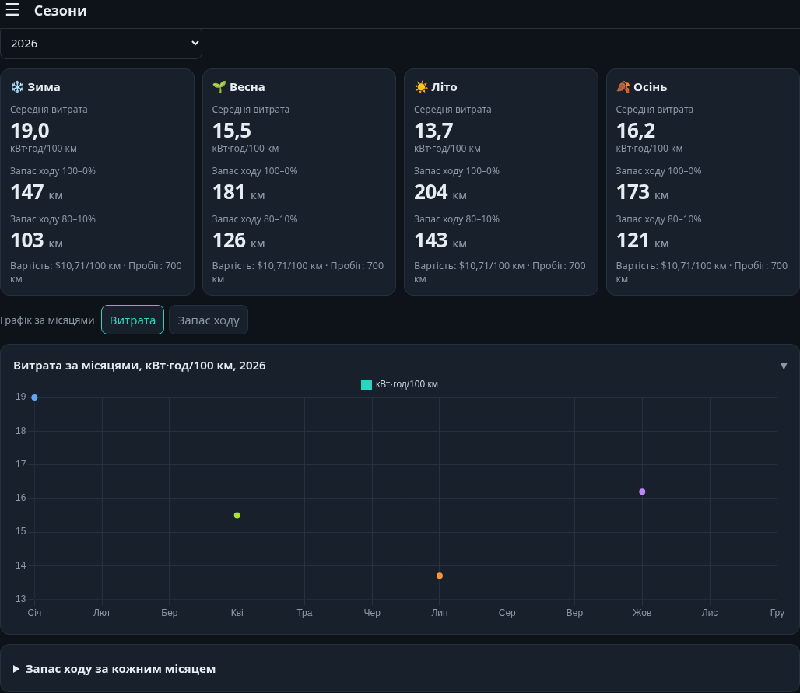

# EV Tracker — облік електромобіля для Home Assistant

**EV Tracker v2.3.7** — україномовне доповнення для Home Assistant, яке допомагає відстежувати заряджання електромобіля, споживання електроенергії, витрати на експлуатацію, економію порівняно з бензиновим автомобілем та орієнтовний термін окупності.

Доповнення працює локально у Home Assistant, має власний вебінтерфейс і зберігає накопичену статистику в базі SQLite.

*Приклад інтерфейсу з демонстраційними даними.*

## Можливості

### 📊 Огляд

- Облік пробігу за показаннями одометра й середньої витрати електроенергії (кВт·год/100 км).
- Збереження для кожного періоду витрати бензинового аналога, ціни А-95, тарифу електроенергії та курсу долара — зміна налаштувань не переписує історичні значення.
- Порівняння вартості поїздок на електромобілі та бензиновому автомобілі, статистика економії й графіки за місяцями.

### 🔌 Зарядки

- Отримання статистики спожитої енергії з датчиків Home Assistant із деталізацією до 5 хвилин, коли такі дані доступні.
- Автоматичне групування інтервалів у сесії заряджання з допуском коротких перерв у даних.
- Необов'язкове використання стану підключення Eveus для розмежування сесій.
- Збереження історії вимірювань у SQLite, а також ручне додавання заряджань поза домом.
- Перегляд тривалості, спожитої електроенергії й оцінки потужності заряджань.

### 💰 Окупність

- Розрахунок накопиченої економії на енергоносіях порівняно з бензиновим аналогом.
- Прогноз залишку до окупності та орієнтовної дати окупності за попередньою статистикою.
- Облік додаткових витрат: записи, позначені для врахування, збільшують загальну суму вкладень, а не зменшують розраховану середню місячну економію.

### 🍂 Сезони

- Середня витрата електроенергії за місяцями та сезонами.
- Орієнтовний запас ходу на повному заряді та у вибраному діапазоні SOC, наприклад від 80% до 10%.
- Вибір року, графіки та контроль мінімального пробігу для розрахунку статистики.
- Налаштовувана корисна ємність тягової батареї.

### ⚙️ Налаштування та дані

- Вибір датчиків енергії Home Assistant.
- Налаштування параметрів електромобіля, бензинового аналога й тарифів.
- Автоматичне отримання ціни бензину А-95 і курсу USD із сайту Мінфін за доступності джерел.
- Експорт та імпорт даних у форматі JSON.

## Встановлення

**Вимоги:** Home Assistant OS із підтримкою Apps (доповнень) і Supervisor. EV Tracker є **доповненням (App / Add-on)**, а не користувацькою інтеграцією HACS або Marketplace.

Або вручну:

1. У Home Assistant відкрийте **Налаштування → Apps (Доповнення) → Install app (Магазин доповнень)**.
2. У меню **⋮ → Репозиторії** додайте `https://github.com/XP2121/ev-tracker`.
3. Знайдіть **EV Tracker** у переліку доступних доповнень і встановіть його.
4. Запустіть EV Tracker та за потреби увімкніть відображення в бічній панелі Home Assistant.

*У старіших версіях Home Assistant відповідний розділ може називатися «Налаштування → Доповнення → Магазин доповнень».*

## Початкове налаштування

1. Відкрийте **EV Tracker → Налаштування** й виберіть датчик енергії з одиницею вимірювання **кВт·год**, для якого Home Assistant формує статистику. За потреби додайте другий датчик.
2. Вкажіть тариф електроенергії, витрату бензинового аналога, вартість автомобіля й інші параметри розрахунку.
3. Для сезонного прогнозу задайте корисну ємність батареї, початковий і мінімальний SOC.
4. У вкладці **Огляд** додайте початкове показання одометра. Після наступного показання EV Tracker зможе розрахувати витрати й економію за пройдений інтервал.
5. За потреби вручну додайте заряджання поза домом та інші витрати.

Для роботи **не потрібна зарядна станція Eveus**: достатньо відповідного датчика спожитої енергії в Home Assistant. Інтеграція Eveus є необов'язковою.

## Важливі особливості розрахунків

- **Запас ходу** є орієнтовним: він розраховується за корисною ємністю батареї й середньою витратою автомобіля. Втрати заряджання з мережі до цього розрахунку не додаються.
- **Окупність** показує, коли накопичена економія на енергоносіях компенсує вказану вартість автомобіля та враховані вкладення. Це не повний розрахунок сукупної вартості володіння (TCO).
- **Сесії заряджання** залежать від якості даних Home Assistant. П'ятихвилинна деталізація доступна не для кожного датчика; для частини історії може використовуватися погодинна статистика. Короткі фактичні відключення іноді можуть об'єднуватися в одну сесію.
- **Дані за місяцями** можуть бути приблизними, коли записи одометра охоплюють кілька місяців: витрата й пробіг розподіляються між ними за тривалістю інтервалу.

## Збереження даних і безпека

Дані зберігаються локально в SQLite за шляхом `/data/ev.db` усередині доповнення. Для перенесення та відновлення передбачений JSON-експорт/імпорт. Перед перевстановленням або переходом з локально встановленої версії рекомендовано зробити резервну копію Home Assistant й експортувати дані EV Tracker: інша інсталяція доповнення може мати окрему базу.

Вебінтерфейс призначений для доступу через **Home Assistant Ingress**. Не відкривайте порт `8099` в інтернет без окремої автентифікації та захисту мережі.

## Технічна інформація

- **Бекенд:** Python 3.12, aiohttp, SQLite.
- **Інтерфейс:** HTML, CSS, JavaScript, Chart.js.
- **Підтримувані архітектури:** `amd64`, `aarch64`.
- **Вихідний код:** [`ev_tracker/`](ev_tracker/).
- **Відомості про сторонні компоненти:** [`THIRD_PARTY_NOTICES.md`](THIRD_PARTY_NOTICES.md).

Вихідний код EV Tracker опубліковано без окремої ліцензії на цей час. Chart.js поширюється за ліцензією MIT.

---

*EV Tracker — незалежний неофіційний проєкт, не пов'язаний з Home Assistant або виробником зарядних станцій Eveus.*
